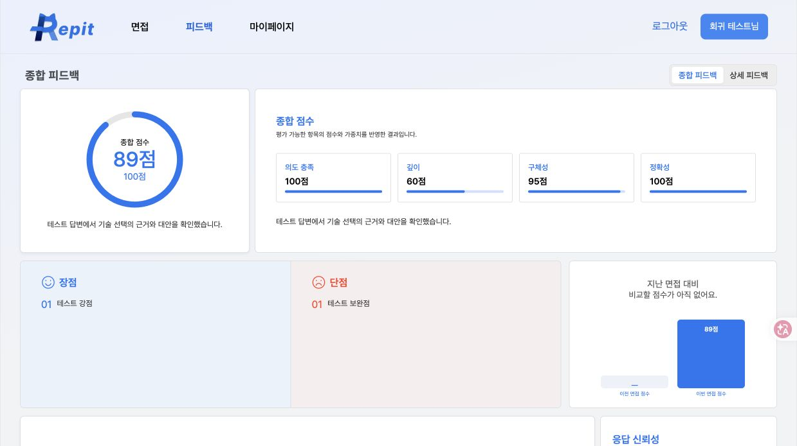
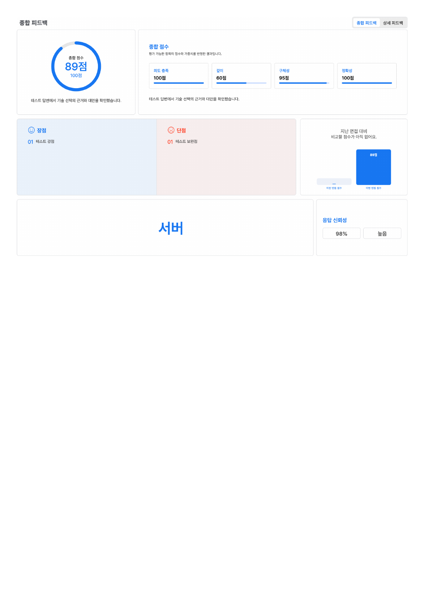

# 종합 피드백 점수·섹션 표시 (#168)

`scoreBreakdown.axes`를 축 이름으로 연결합니다. 순서는 의도 충족(INTENT), 깊이(DEPTH), 구체성(SPECIFICITY), 정확성(ACCURACY)이며, 종합 점수는 기존 `totalScore`를 그대로 씁니다.

- 0점은 0점입니다. `score:null, weight:null`이 명시된 축은 “해당 없음”, 누락·잘못된 값·중복 축은 “미제공”입니다.
- 옛 응답의 의도 점수만 `intentAlignmentScore`로 보완합니다. 해당 없음은 덮어쓰지 않습니다.
- 분석 완료 결과에 고정 “분석 대기”를 만들지 않습니다. 점수 없는 결과를 조회한다고 재채점하지 않습니다.

| 유형 | 답변 방식 | 면접관별 코멘트 | 음성 영역 |
|---|---|---|---|
| SOLO | TEXT | 숨김 | 숨김·음성 요청 없음 |
| SOLO | VOICE | 숨김 | 표시 |
| MULTI | TEXT | 표시 | 숨김·음성 요청 없음 |
| MULTI | VOICE | 표시 | 표시 |

면접 유형은 면접 조회의 mode 우선, 누락 시 피드백 mode를 씁니다. 둘 다 없으면 면접관별 섹션을 숨깁니다. 빈 personas 개수로 유형을 추측하지 않습니다.

답변 방식은 [API 이슈 #107](https://github.com/Alpha-origin/Repit-api-server/issues/107)의 `answerMode: TEXT | VOICE | null` 계약입니다. 새 제출에만 설정 값을 추가하며 저장된 UNKNOWN/SUBMITTING 본문·요청키에는 새 필드를 주입하지 않습니다. 생성·재진입에서도 서버 값을 보존합니다.

기존 null 기록은 `/api/interviews/{id}/audio-analysis`의 녹음 답변 목록을 보조 근거로 씁니다. 완료 응답의 빈 녹음 목록은 섹션을 숨기지만 기록 자체를 TEXT로 보정하지 않습니다. 업로드가 전부 실패한 옛 VOICE 기록도 구분할 수 없는 한계가 있습니다. 조회 오류는 텍스트로 단정하지 않고 재확인 버튼을 표시합니다.

음성 조회는 PENDING에만 5초 간격·최대 5분 진행하며 화면 이탈·ID 변경 시 취소합니다. 완료/부분/결과 없음/실패/조회 오류를 구분합니다. 원시 지표에서 임의 100점 점수를 만들지 않고 음성 점수·코멘트는 준비 중으로 안내합니다. 본문 채점은 음성 조회를 기다리지 않습니다. 키워드·신뢰성·PDF 기능은 TEXT에서도 유지합니다.

## 검증 (2026-10-19)

- `node --test tests/*.test.mjs`: 40개 통과.
- `npm run lint`: 오류 0, 기존 router.tsx unused eslint-disable 경고 1개.
- `npm run build`: 통과.
- 실제 브라우저 + 독립 HTTP fixture: SOLO/MULTI × TEXT/VOICE, 새로고침, null 기록의 녹음 있음/없음, 503 및 재확인, PENDING→READY 자동 갱신, PENDING 도중 이탈 확인.
- fixture 요청 기록: TEXT 4201·4203의 음성 API 0회, VOICE 4202·4204 각 1회, 오류 4207 재확인 포함 2회, PENDING→READY 4208은 2회, 화면 이탈한 4209는 1회에서 중단.
- SOLO TEXT PDF 다운로드 후 Poppler로 A4 1쪽 렌더링: 네 축과 키워드·신뢰성 유지, 면접관·음성 섹션 없음, 겹침·잘림 없음.
- 자체 리뷰: 축 null/0 구분, 필드 없는 구형 제출 본문 불변, effect 취소와 stale 응답 차단, PDF의 숨김 조건 확인.

fixture 실행:

```sh
node tests/feedback-visibility-fixture.mjs
# http://127.0.0.1:5183/__feedback-fixture
```

실제 서버·유료 모델을 사용하지 않는 테스트 데이터입니다. 실서버를 연결한 별도 포트에서 기존 56번 결과를 열었으나 로그인 화면으로 이동하여 **수정 후 실서버 재면접·실모델 연동은 미검증**입니다. 실행 중 localhost:5173과 DB를 변경하지 않았습니다.

선행 Web #167, API #106·#107 변경 통합 후 실제 환경에서 새 텍스트 면접을 확인해야 합니다. 점수 생성·가중치·Analysis·Chat 계약은 변경하지 않습니다.




